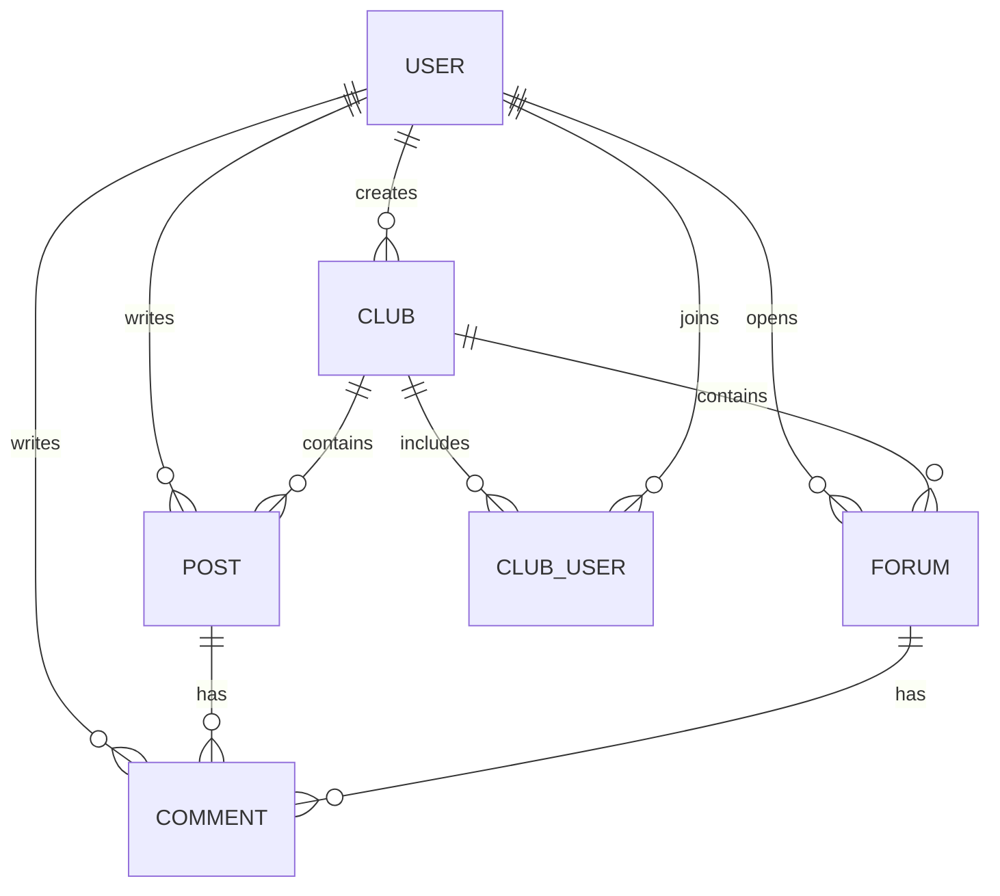

# Спецификация требований: Платформа для камерных сообществ (MVP)

> **Описание:** Документ описывает видение, границы, ролевую модель и ключевые требования к MVP веб-платформы для создания и управления тематическими клубами. Создан в рамках пет-проекта для отработки навыков системного анализа и проектирования.

---

## Часть 1. Vision & Scope

### 1.1 Видение (Vision)
**Бизнес-проблема:** Глобальные соцсети (ВК, Telegram) не предоставляют структурированных инструментов для управления локальными сообществами: алгоритмические ленты хоронят важные обсуждения, нет гибкого разграничения прав доступа, а поиск единомышленников тонет в общем информационном шуме.

**Решение:** Специализированная веб-платформа для создания и управления камерными сообществами, где приоритет отдается структурированному контенту клуба (форумы, темы), а не личным профилям пользователей.

**Целевая аудитория:**
*   **Организатор (Владелец клуба):** Человек с идеей, желающий поделиться ею. *Цель:* собрать аудиторию и структурировать обсуждения. *Боль:* усталость от модерации хаоса в чатах соцсетей.
*   **Участник клуба:** Человек, присоединившийся к кружку по интересам. *Цель:* находить актуальные обсуждения и материалы. *Боль:* сложность поиска старых полезных сообщений в бесконечном потоке чатов.
*   **Неавторизованный пользователь (Гость):** Человек, ищущий единомышленников. *Цель:* найти сообщество по интересам. *Боль:* не знает, с чего начать поиск в глобальных сетях.

**Уникальное ценностное предложение (UVP):** Стремление к нишевости и камерности. Максимум внимания профилю клуба и его форуму, минимум внимания личным страничкам участников.

### 1.2 Границы и MVP (Scope)
**In Scope (Делаем в MVP):**
1. Регистрация и авторизация аккаунта.
2. Создание клуба.
3. Вступление в публичный клуб.
4. Создание постов (закрепленная информация, анонсы).
5. Создание обсуждений (формат форума, тредов).
6. Настройки приватности (публичный/закрытый) и лимита участников.
7. Поиск клубов по названию.

**Out of Scope (Откладываем на Phase 2+):**
1. Витрина лучших клубов и теги категорий.
2. Платные подписки и монетизация.
3. Расширенные возможности визуального оформления страниц клубов.

**Допущения и ограничения:**
*   Работаем в свободное время (pet-project).
*   Только веб-версия (без мобильных приложений).
*   Бюджет на инфраструктуру: 0 руб. (используются бесплатные тарифы).

---

## Часть 2. Ролевая модель и Матрица прав доступа (RBAC)

### 2.1 Описание ролей
*   **Неавторизованный пользователь:** Зашел на сайт, но не вошел в аккаунт. Может искать клубы и просматривать публичные профили. Не может вступать в клубы и создавать контент.
*   **Новый пользователь:** Успешно аутентифицирован. Пока что не состоит ни в одном клубе и не создал ни одного своего клуба. Может вступать в публичные клубы, создавать свои клубы и комментировать доступный контент. Не имеет доступа к закрытым клубам без приглашения.
*   **Участник клуба:** Авторизованный пользователь, вступивший в клуб. Может создавать посты/обсуждения и комментировать их внутри клуба. Не может управлять настройками клуба.
*   **Администратор (Владелец) клуба:** Авторизованный пользователь, создавший клуб. Имеет полные права на управление настройками, составом участников и контентом *только своего* клуба.

### 2.2 Матрица прав доступа
| Действие / Сущность | Неавторизованный | Новый пользователь | Участник клуба | Администратор клуба |
| :--- | :---: | :---: | :---: | :---: |
| **Регистрация / Вход** | ✅ | ❌ *(уже вошел)* | ❌ | ❌ |
| **Выход из аккаунта** | ❌ *(еще не вошёл)* | ✅ | ✅ | ✅ |
| **Поиск клуба по названию** | ✅ | ✅ | ✅ | ✅ |
| **Просмотр публичного клуба** | ✅ | ✅ | ✅ | ✅ |
| **Просмотр закрытого клуба** | ❌ | ❌ | ✅ | ✅ |
| **Вступление в публичный клуб** | ❌ *(редирект на регистрацию)* | ✅ |  ✅ *(уже участник)* | ✅ |
| **Создание нового клуба** | ❌ | ✅ | ✅ | ✅ |
| **Редактирование настроек клуба** | ❌ | ❌ | ❌ | ✅ *(только своего)* |
| **Создание поста/обсуждения** | ❌ | ❌ | ✅ *(в своих клубах)* | ✅ *(в своих клубах)* |
| **Удаление участника из клуба** | ❌ | ❌ | ❌ | ✅ *(только своего)* |

---

## Часть 3. Ключевые User Stories (MVP)

### US-1: Поиск клуба
> **Как** любой пользователь системы (гость, новый пользователь, участник или администратор), \
> **Я хочу** найти клуб по точному или частичному совпадению названия, \
> **Чтобы** оценить его тематику и принять решение о регистрации или вступлении.

**Acceptance Criteria (Given-When-Then):**
- **Основной сценарий (Успешный поиск):**
  - **Дано** пользователь находится на странице поиска.
  - **Когда** он вводит «Книжный» и нажимает «Найти».
  - **Тогда** система выводит список публичных клубов, содержащих «Книжный» в названии.
- **Альтернатива 1 (Ничего не найдено):**
  - **Дано** пользователь ввел запрос.
  - **Когда** в базе нет подходящих публичных клубов.
  - **Тогда** система отображает текст «Клубы не найдены. Попробуйте изменить запрос» и предлагает очистить фильтры.
- **Примечание:** Страница поиска и формат выдачи идентичны для всех ролей. Закрытые клубы в результатах поиска для неавторизованных пользователей и новых пользователей отсутствуют.

---

### US-2: Регистрация аккаунта
> **Как** гость, \
> **Я хочу** создать аккаунт, \
> **Чтобы** получить возможность вступать в клубы и создавать свои.

**Acceptance Criteria:**
- **Основной сценарий:**
  - **Дано** гость на странице регистрации.
  - **Когда** он вводит уникальный логин, валидный email и пароль, соответствующий политике безопасности, и нажимает «Зарегистрироваться».
  - **Тогда** система создает аккаунт, выполняет автоматический вход и присваивает роль «Новый пользователь».
- **Альтернатива 1 (Email уже занят):** Система выдает ошибку «Пользователь с таким email уже существует» и предлагает перейти на страницу входа.
- **Альтернатива 2 (Слабый пароль):** Система подсвечивает поле и выводит требования к паролю.

---

### US-3: Вход в систему (Аутентификация)
> **Как** гость с существующим аккаунтом, \
> **Я хочу** войти в систему по логину/email и паролю, \
> **Чтобы** получить доступ к своим клубам и функциям.

**Acceptance Criteria:**
- **Основной сценарий:**
  - **Дано** пользователь вводит корректные данные.
  - **Когда** нажимает «Войти».
  - **Тогда** система авторизует пользователя и перенаправляет на главную страницу с учетом его текущих ролей (участник/администратор).
- **Альтернатива 1 (Неверные данные):**
  - **Когда** введен неверный логин или пароль.
  - **Тогда** система выдает единую ошибку «Неверный логин или пароль» (в целях безопасности не раскрываем, что именно неверно или существует ли аккаунт).

---

### US-4: Выход из системы
> **Как** авторизованный пользователь, \
> **Я хочу** завершить текущую сессию, \
> **Чтобы** защитить свой аккаунт при использовании общего устройства или сменить пользователя.

**Acceptance Criteria:**
- **Основной сценарий:**
  - **Дано** пользователь авторизован.
  - **Когда** он нажимает кнопку «Выйти» в меню профиля.
  - **Тогда** система уничтожает сессию, сбрасывает роль до «Гостя» и перенаправляет на главную страницу.

---

### US-5: Создание нового клуба
> **Как** новый пользователь (или участник/администратор других клубов), \
> **Я хочу** создать новый клуб, \
> **Чтобы** объединить людей вокруг интересующей меня темы.

**Acceptance Criteria:**
- **Основной сценарий:**
  - **Дано** пользователь нажал «Создать клуб».
  - **Когда** он заполнил обязательные поля (название, тематика, описание), выбрал тип (публичный/закрытый) и лимит участников, затем нажал «Создать».
  - **Тогда** система создает клуб, присваивает создателю роль «Администратор клуба» для этой сущности и открывает страницу нового клуба.
- **Альтернатива 1 (Название занято):** Система выдает ошибку «Клуб с таким названием уже существует».
- **Альтернатива 2 (Пустые поля):** Система подсвечивает незаполненные обязательные поля и не отправляет форму.

---

### US-6: Вступление в публичный клуб
> **Как** новый пользователь, \
> **Я хочу** вступить в публичный клуб, \
> **Чтобы** получить доступ к его закрытым материалам, постам и обсуждениям.

**Acceptance Criteria:**
- **Основной сценарий (Авторизованный, не является участником):**
  - **Дано** пользователь находится на странице публичного клуба и не состоит в нём.
  - **Когда** он нажимает кнопку «Присоединиться».
  - **Тогда** система добавляет его в состав участников (создает запись в сущности Membership со статусом `active`).
  - **И** кнопка «Присоединиться» заменяется на неактивный статус «Вы участник».
  - **И** пользователю становятся доступны функции создания постов и комментариев внутри этого клуба.
- **Альтернатива 1 (Пользователь уже участник):**
  - **Дано** пользователь уже состоит в клубе.
  - **Когда** открывается страница клуба.
  - **Тогда** кнопка «Присоединиться» **не отображается** вовсе, виден только статус «Вы участник».
  - **И** при попытке повторного вступления (например, прямым API-запросом) система возвращает ошибку «Вы уже являетесь участником этого клуба» и не создает дубль записи.
- **Альтернатива 2 (Неавторизованный пользователь / Гость):**
  - **Дано** гость просматривает страницу публичного клуба.
  - **Когда** он нажимает кнопку «Присоединиться».
  - **Тогда** система перенаправляет его на страницу входа/регистрации, сохраняя `return_url`.
  - **И** после успешной аутентификации возвращает на страницу этого клуба, где пользователь может завершить действие вступления.
- **Альтернатива 3 (Клуб закрытый):**
  - Кнопка «Присоединиться» не отображается. Вместо неё показана пометка «Закрытый клуб — вступление только по приглашению».
- **Альтернатива 4 (Достигнут лимит участников):**
  - Система возвращает ошибку «В клубе достигнут максимальный лимит участников».

---
## Часть 4. Модель данных

Типы указаны обобщённо (SQL-диалект независимый). «NOT NULL» — поле обязательное,
«NULL» — необязательное. Удаление во всех сущностях мягкое (soft delete):
запись не стирается физически, а помечается датой в deleted_at.

### 4.1 user — пользователь

| Поле | Тип | Обязательность | Описание |
|---|---|---|---|
| id | BIGINT, PK | NOT NULL | Уникальный идентификатор пользователя |
| display_name | VARCHAR(100) | NOT NULL | Отображаемое имя |
| login | VARCHAR(50), UNIQUE | NOT NULL | Логин для входа |
| email | VARCHAR(255), UNIQUE | NOT NULL | Электронная почта |
| password_hash | VARCHAR(255) | NOT NULL | Хеш пароля (открытый пароль не храним) |
| reg_at | TIMESTAMP | NOT NULL | Дата и время регистрации |
| deleted_at | TIMESTAMP | NULL | Признак удаления аккаунта (soft delete) |

### 4.2 club — клуб

| Поле | Тип | Обязательность | Описание |
|---|---|---|---|
| id | BIGINT, PK | NOT NULL | Уникальный идентификатор клуба |
| owner_user_id | BIGINT, FK → user.id | NOT NULL | Пользователь-владелец клуба |
| name | VARCHAR(100) | NOT NULL | Название клуба |
| topic | VARCHAR(255) | NOT NULL | Тематика клуба |
| description | TEXT | NULL | Описание клуба |
| layout | VARCHAR(50) | NULL | Шаблон оформления страницы клуба |
| type | VARCHAR(20) | NOT NULL | Тип клуба: public / closed |
| created_at | TIMESTAMP | NOT NULL | Дата и время создания |
| deleted_at | TIMESTAMP | NULL | Признак удаления клуба |

### 4.3 post — пост

| Поле | Тип | Обязательность | Описание |
|---|---|---|---|
| id | BIGINT, PK | NOT NULL | Уникальный идентификатор поста |
| club_id | BIGINT, FK → club.id | NOT NULL | Клуб, в котором опубликован пост |
| author_user_id | BIGINT, FK → user.id | NOT NULL | Автор поста |
| name | VARCHAR(200) | NOT NULL | Заголовок поста |
| text | TEXT | NOT NULL | Содержимое поста |
| is_pinned | BOOLEAN | NOT NULL, default false | Закреплён ли пост |
| is_comments_open | BOOLEAN | NOT NULL, default true | Открыты ли комментарии |
| like_counter | INTEGER | NOT NULL, default 0 | Счётчик лайков |
| created_at | TIMESTAMP | NOT NULL | Дата и время публикации |
| deleted_at | TIMESTAMP | NULL | Признак удаления поста |

### 4.4 forum — обсуждение (тред)

| Поле | Тип | Обязательность | Описание |
|---|---|---|---|
| id | BIGINT, PK | NOT NULL | Уникальный идентификатор обсуждения |
| club_id | BIGINT, FK → club.id | NOT NULL | Клуб, к которому относится обсуждение |
| author_user_id | BIGINT, FK → user.id | NOT NULL | Создатель обсуждения |
| name | VARCHAR(200) | NOT NULL | Заголовок обсуждения |
| text | TEXT | NULL | Описание обсуждения / стартовый пост |
| is_comments_open | BOOLEAN | NOT NULL, default true | Можно ли добавлять комментарии |
| like_counter | INTEGER | NOT NULL, default 0 | Счётчик лайков |
| is_closed | BOOLEAN | NOT NULL, default false | Закрыто ли обсуждение |
| created_at | TIMESTAMP | NOT NULL | Дата и время создания |
| deleted_at | TIMESTAMP | NULL | Признак удаления обсуждения |

### 4.5 comment — комментарий

| Поле | Тип | Обязательность | Описание |
|---|---|---|---|
| id | BIGINT, PK | NOT NULL | Уникальный идентификатор комментария |
| post_id | BIGINT, FK → post.id | NULL | Пост-родитель (заполнен, если комментарий к посту) |
| forum_id | BIGINT, FK → forum.id | NULL | Обсуждение-родитель (заполнено, если комментарий к форуму) |
| author_user_id | BIGINT, FK → user.id | NOT NULL | Автор комментария |
| text | TEXT | NOT NULL | Текст комментария |
| like_counter | INTEGER | NOT NULL, default 0 | Счётчик лайков |
| created_at | TIMESTAMP | NOT NULL | Дата и время создания |
| deleted_at | TIMESTAMP | NULL | Признак удаления комментария |

**Ограничение:** `CHECK ((post_id IS NULL) <> (forum_id IS NULL))` —
ровно одно из двух полей-родителей заполнено: комментарий принадлежит
либо посту, либо обсуждению, но не обоим сразу.

### 4.6 club_user — связующая таблица участия (M:N club ↔ user)

| Поле | Тип | Обязательность | Описание |
|---|---|---|---|
| club_id | BIGINT, FK → club.id, часть PK | NOT NULL | Клуб, в котором состоит пользователь |
| user_id | BIGINT, FK → user.id, часть PK | NOT NULL | Пользователь-участник |
| role | VARCHAR(20) | NOT NULL, default 'member' | Роль в клубе (member / moderator) |
| joined_at | TIMESTAMP | NOT NULL | Дата и время вступления |
| status | VARCHAR(20) | NOT NULL, default 'active' | Статус участия: active / left / banned |

**Составной первичный ключ (club_id, user_id):** одна запись = один пользователь в одном клубе; 
дубликаты участия невозможны на уровне БД. Роль «администратор клуба» не хранится здесь: 
админ — это владелец через `club.owner_user_id`, чтобы не дублировать логику прав в двух местах.

### 4.7 Диаграмма связей



---

## Часть 5. Диаграмма вариантов использования (Use Case)

```mermaid
flowchart LR
    subgraph BC["Платформа клубов (MVP)"]
        UC1(["Поиск клуба по названию"])
        UC2(["Просмотр публичного клуба"])
        UC3(["Регистрация"])
        UC4(["Вход в систему"])
        UC5(["Создание нового клуба"])
        UC6(["Вступление в публичный клуб"])
        UC7(["Выход из аккаунта"])
        UC8(["Просмотр закрытого клуба (своего)"])
        UC9(["Создание поста / обсуждения"])
        UC10(["Комментирование постов и обсуждений"])
        UC11(["Управление настройками клуба"])
        UC12(["Удаление участников"])
        UC13(["Создание ссылки-приглашения"])
    end

    G(("Гость"))
    A(("Новый пользователь"))
    M(("Участник клуба"))
    O(("Администратор клуба"))

    M -->|обобщение| A
    O -->|обобщение| M

    G --- UC1
    G --- UC2
    G --- UC3
    G --- UC4

    A --- UC1
    A --- UC2
    A --- UC5
    A --- UC6
    A --- UC7

    M --- UC8
    M --- UC9
    M --- UC10

    O --- UC11
    O --- UC12
    O --- UC13
